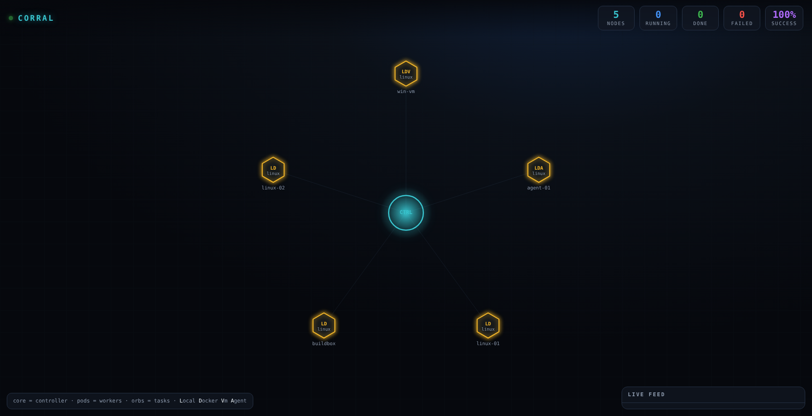
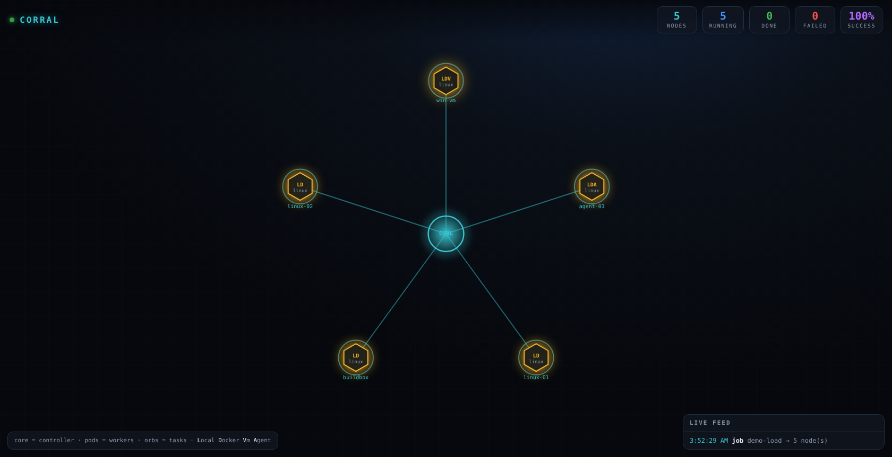

# The dashboard

The dashboard is a live, game-like view of the fleet, not a table of numbers. Start the controller with it and open the page:

```sh
corral controller --dashboard
# then open http://127.0.0.1:8787/
```

## What you see

- **The core** at the center is the controller.
- **The pods** in orbit are the workers. Each pod shows its executor badges (`L`ocal, `D`ocker, `V`m, `A`gent), its OS, and its node id, tinted by operating system. A pod grows a pulsing ring while it is running a task.
- **The orbs** are tasks. When a job fans out, an orb flies from the core to each matching worker, the worker lights up and sparks as its log streams, and when the task finishes an orb flies back and bursts green for success or red for failure.
- **The HUD** across the top counts live nodes, running tasks, completed and failed tasks, and the success rate.
- **The live feed** in the corner is the event stream in words: nodes joining and leaving, jobs fanning out, and tasks finishing.





## Interacting

- **Hover** a pod to see its full id, OS and architecture, executors, labels, and how many tasks it is running.
- **Click** a pod to filter the live feed to that worker's log lines. Click it again to clear the filter.

## How it is driven

The page is static HTML served by the controller. It seeds from the REST API (`/api/nodes`, `/api/jobs`) and then subscribes to the controller's event stream over the `/ws/events` WebSocket, so it updates the instant something happens. It is read-only: it shows the fleet, it does not drive it. Submitting work stays with the CLI and the MCP server.

Everything is drawn on one canvas with no external libraries, so the page is a single file and loads instantly.
